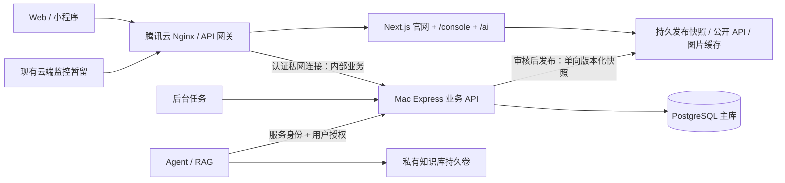

# 混合部署架构审计（2026-11-01）

## 结论

继续使用现有 Monorepo、Next.js、Express、PostgreSQL 和权限模型。先把进程启动与页面渲染解耦，再实现发布快照；不要先搬数据库再补官网离线能力。第一阶段仅在本地新分支实施，生产未写入、未重启、未部署，未导出业务明细或凭证值。

## 实际环境与版本证据

| 项目 | 腾讯云实测 | Mac mini 实测 |
| --- | --- | --- |
| 系统/架构 | Ubuntu 22.04.5，x86_64 | macOS 26.6.2，arm64 |
| CPU/内存 | 2 vCPU，3.6 GiB；可用约 1.9 GiB，无 swap | 10 核，24 GiB；OrbStack 分配约 11.7 GiB |
| 磁盘 | 根盘 59 GiB，已用 20 GiB，可用 37 GiB | 根卷可用约 412 GiB |
| 运行时 | Node 24.18.0、npm 11.16.0（NVM 路径）；PostgreSQL 14.22；Nginx 1.18 | Node 24.18.0、npm 11.16.0；Docker 29.8.2、Compose 5.5.0 |
| 部署 | `/srv/rnav_platform`，systemd `rnav-platform`；每天 scholarly-sync timer | Docker context `orbstack`；已有 Minecraft 容器，不改动 |
| 网络 | 80/443 Nginx；4090/4092/5432 仅 loopback；SSH 22 | 默认路由经过 utun6；到云端 SSH 成功；公网入站、固定出口、隧道与断网重连未验证 |

本地 `main`、GitHub `main` 和服务器 HEAD 都是 `0aa4ed8c1343918289fb8aa5a7c8acccd0b20861`。三者提交一致；本地和生产工作区干净，全部受 Git 跟踪文件的聚合 SHA-256 均为 `dbfdb55bf61bc193c4ed828c97dab0f4f7ad6f275664721da78e130738a6b90e`。服务器 origin 仍为旧组织 `R-Navigation/rnav-platform`，本地已经是 `Locomotion-Lab/rnav-platform`；本次未修改服务器 remote。

生产 Nginx 与仓库模板一致，所有请求含 WebSocket 均转发 4090。systemd 工作目录、环境文件路径、可执行文件路径已检查；仅提取配置键及必要非敏感字段。非登录 SSH 的 PATH 没有 Node/npm，不代表未安装；任务及将来运维必须明确运行时路径。

4092 还有返回健康的同目录 Node 进程，PM2 daemon 存在；PM2 历史 dump 含旧 `/srv/rnav/backend`、`/srv/rnav_monitor/backend` 定义，但 dump 不能证明当前进程归属。停止或清理前必须进一步核实，不能依据旧定义直接停服务。Docker/PM2 可执行文件未在默认 PATH 找到；没有据此断言机器未安装任何 Docker/PM2。

## 仓库结构与耦合

- `apps/web`：Next.js 16.3.5、React 19；官网、登录、Console 和 Next API 转发。SSR 使用 `RNAV_API_INTERNAL_URL`（默认本机 4090），公开数据 fetch revalidate 60 秒，失败返回降级内容；该缓存不能保证冷启动或长时间离线仍展示完整数据。成员详情与图片同样需要公开 API。
- `server/index.ts`：Express、Next prepare、所有业务路由、PostgreSQL pool、监控 WebSocket 和离线检查同进程。`createApp` 已支持不挂 Next，为渐进拆分提供接缝。
- `server/services`：成员/账号、权限、CMS、资产与平台、监控、采购、媒体、通知、论文同步有独立 service。路由通常做认证、权限、同源检查；AI 应复用这些 service 和策略，而非直接 SQL。
- `scripts/db` 与 `server/db/migrations`：既有遗留导入验证与 checksum/advisory-lock 迁移机制。复用迁移，不重写迁移历史，不执行 legacy import 代替主库迁移。
- 媒体文件通过 COS SDK 写入对象存储，数据库保存引用和生命周期；当前没有可直接替换 COS 的本地文件后端。仅给容器加空文件卷不构成媒体持久化。
- 当前 `/ai` 不存在。后续增加页面入口和 API 合约即可，不提前引入完整模型服务。

## 数据库实测与边界

生产 `rnav_platform` 约 32 MB，68 个 public 表、728 个列、96 个外键，42 个已应用迁移全部与本地 SQL SHA-256 一致。仅使用 `BEGIN READ ONLY`、查询超时和系统目录/聚合查询；没有导出生产数据库。可提交的结构元数据见 [production-schema-audit.json](production-schema-audit.json)，不含行值或秘密。

精确计数：users 40，user_profiles 40，lab_assets 79，facility_items 3，schema_migrations 42。统计目录估计值（不是逐表精确数）：platforms 14，research_items 154，media_assets 56，procurement_requests 32，device_telemetry 3136。旧 `rnav_site`、`rnav_monitor`、staging、phase2_check 数据库仍存在，均不清理。

关键关系：

- `users → user_profiles` 是成员维护主线；旧 `team_members` 仍被 profile 引用，不能删除。公开成员严格经过 `public_visible` 和 `public_fields` 映射；公开联系方式可能是成员主动授权字段，不能粗暴全部删除或默认全部发布。
- 用户关联权限模板、覆盖、会话、通知、审计、采购审批、资产领用、论文身份和同步记录。权限是 normal/super 基层级 + 模板 + grant/revoke，plus 为派生展示层级；保留毕业成员限制及首次修改密码限制。
- `lab_assets → lab_platforms / device_types / users / procurement_requests`。公开展示读取 public profile 与公开规格；平台公开组件还有 summary/detail 开关。公开设备信息不等于完整设备台账。
- 现有 3 条 `facility_items` 与 asset/platform-backed 公共展示并存，须保留兼容及关联规格。
- `scholarly_works / scholarly_work_members → research_items / users`，公开成员论文需额外导出详情关联，不能只同步团队列表。
- `system_secrets` 使用 SESSION_SECRET 派生加密；迁移必须安全保留旧秘密，不能随意生成新 secret 导致密文不可解密。凭证只在隔离环境中以秘密文件配置。

## 风险与待验证

| 优先级 | 风险 | 控制措施 |
| --- | --- | --- |
| P0 | Mac 离线导致官网内容/图片缺失 | 云端保留完整、持久、可回退的发布快照；断链后重启云端冷读验收 |
| P0 | 内部身份、资产私有字段或知识库被同步公开 | 使用现有公开投影 + 发布清单白名单；禁止同步 users、sessions、secrets、notes、审批明细；发布差异预览和负面测试 |
| P0 | 双主写入及回滚丢失新数据 | 每个域只设一个写入源；切换窗口冻结写入；切换后回滚先导出 Mac 增量，不直接启用旧库写入 |
| P0 | 监控要求保持现状，与移走云端主库冲突 | 首期完整主库留云；后续先隔离监控身份/只读依赖，验证 ingest、WS、离线任务，再移交主库；不复制两套可写用户库 |
| P1 | COS 与数据库恢复时间不一致 | 对象版本/清单与 DB 备份共同记录；暂不迁移 COS，公开图片云端可独立访问 |
| P1 | x86 到 ARM，PG 跨版本及 native sharp | PG14 同 major、逻辑备份恢复、ARM 原生构建；升级 major 单独进行 |
| P1 | Mac 当前 sleep=1，autorestart=0；与 Minecraft 竞争 | 本次仅记录；上线前经确认配置常开、断电恢复、资源预算和异地备份 |
| P1 | 私网连接未建，公网安全组未审计 | Mac 主动出站受认证隧道/VPN；API/PG 不公开暴露；验证重连、限时、同源 Cookie/CSRF/转发头可信边界 |
| P1 | 旧 PM2/4092、NVM 路径与 systemd 差异 | 查明依赖和启动来源，编制具体变更单，确认后处理 |
| P1 | 历史备份存在但无近期恢复证据 | 观察到 9 月备份文件；未读取备份内容，未验证其可恢复性；切换前新备份并完整隔离恢复 |
| P2 | Agent/小程序鉴权尚缺 | 定义 versioned API、服务身份、用户授权及审计合约；不向 Agent 发 super Cookie 或 DB URL |

未验证：安全组、TLS 到期、长期网络稳定性、COS 对象完整性、恢复演练、真实浏览器/设备联调、生产构建产物是否来自所示 HEAD。源文件匹配和健康端点正常不等于所有这些项目已通过。

## 目标方案

公网保持同源入口，业务网关不可用返回受控 503，不无限等待；官网读取云端本地持久快照，与 Mac 的可用性解耦。Mac 不需要公网端口；优先主动出站连接。沿用 COS 公开资源，云端图片缩略图缓存及其源 URL 校验继续工作。

发布协议：Mac 从一致性只读视图生成现有 PublicSiteService 的白名单 DTO（bootstrap/home/directions/homepage/research/news/team/facilities/contact 和所有公开成员详情）；包含 schemaVersion、publicationId、前一版 ID、generatedAt、内容哈希及媒体清单。人工筛选/批准后由任务主动推送。云端验证身份、版本、尺寸、schema、哈希、防重放，写临时目录后原子切换 current，并保留上一版。失败保留上一版；撤回成员及媒体删除也按整版替换传播。发布历史和告警保存在内部；云端不持有主库凭据。签名或 mTLS 的具体方案在连通性阶段选定，不在无凭证环境下伪装已实现。

Agent/小程序 API 合约：预留 `/api/v1`，服务身份与代表用户权限取交集；沿用现有权限、版本冲突、审计和事务；标准错误 `{ code, message, requestId }`，分页/过滤/幂等键和 OpenAPI。第一阶段不新增未鉴权的写端点，也不宣称现有 Cookie API 已兼容小程序。

## 分阶段实施与门槛

1. **本地基础拆分（本分支）**：API-only 可选启动；默认 unified 不变；Mac Compose PG14/API/显式迁移任务/可选 scholarly 任务，数据卷和备份；单元、类型、构建及隔离空库 smoke。禁止接入生产凭证和数据。
2. **公开发布闭环**：快照 schema、生成/批准/传输/原子接收、云端无主库 public reader，覆盖成员详情/图片/撤回；冻结 DTO，增加隐私负面测试、旧版本拒收、断网与冷启动测试。
3. **私网与业务入口**：云端 API 网关、独立 Next、认证/CSRF/upload timeout/WS 回归；保留 /console，增加 /ai 占位；隔离监控依赖；Agent/RAG 的接口和持久卷契约，不实现完整 AI。
4. **授权后迁移**：按下述方案备份、隔离恢复并验证真实数据；审核具体生产变更单后冻结写入、最终备份、切主库及业务网关。保留监控链路，观察与回滚。此阶段任何生产写入、备份落盘、服务调整和部署都须用户确认。
5. **后续**：Agent 最小权限服务身份、RAG 接入、小程序；采购保持兼容，升级低优先级。

## 数据迁移、备份与回滚方案

- 本次不产生生产备份文件。获批后在维护窗口用 PostgreSQL14 `pg_dump -Fc`、必要角色/扩展清单、序列/FK/迁移校验和和精确表计数建立基线；单独安全备份运行环境秘密（尤其 SESSION_SECRET）和 COS 对象版本清单。加密保存并异地复制，禁止 Git。
- 在隔离新库中 `pg_restore --exit-on-error --single-transaction --no-owner --no-privileges`，重新授予最小权限；核对所有表精确计数、关键关系/序列、迁移校验和、公开投影及媒体哈希；测试权限、成员修改、设备领用、论文关联，副作用使用隔离 COS/停用任务。
- RPO/RTO 由演练实测后确定；初始建议每天加密逻辑备份、保留 7 日 + 4 周、异地副本，每月隔离恢复。若要求分钟级 RPO，再引入 WAL 归档，不能把每日 dump 描述成零丢失。
- 文件：COS 保持现有对象持久化并启用/核实版本保护；未来本地 RAG 原始文件和索引分别用命名卷，停写或一致性快照后备份。可重建索引也须保留原始文件和元数据。不运行 `compose down -v` 或 volume prune。
- 切换前停止业务写入，监控仍可持续采集（需事先确认其独立存储方案）；最终快照恢复验收后只启用 Mac 主写。只有确认公开快照离线测试通过才移除云端内部数据依赖。
- 回滚：保留旧版本代码、Nginx/systemd 配置、旧库和上版公开快照；切换后失败先冻结 Mac 写入、备份/核对新增记录，再按已演练增量回灌或恢复策略回退。无新增写入才可直接恢复旧路由；不能盲目回旧库造成数据丢失。
